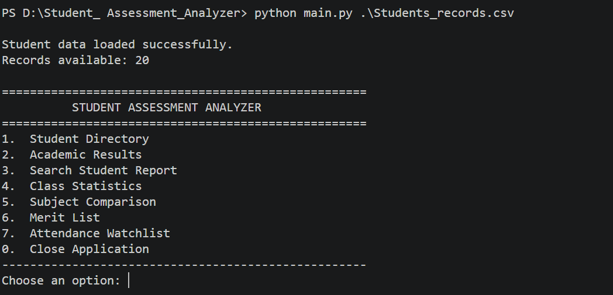
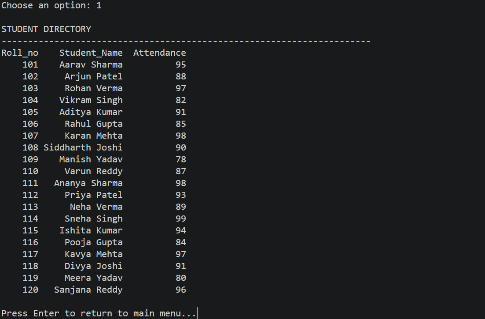
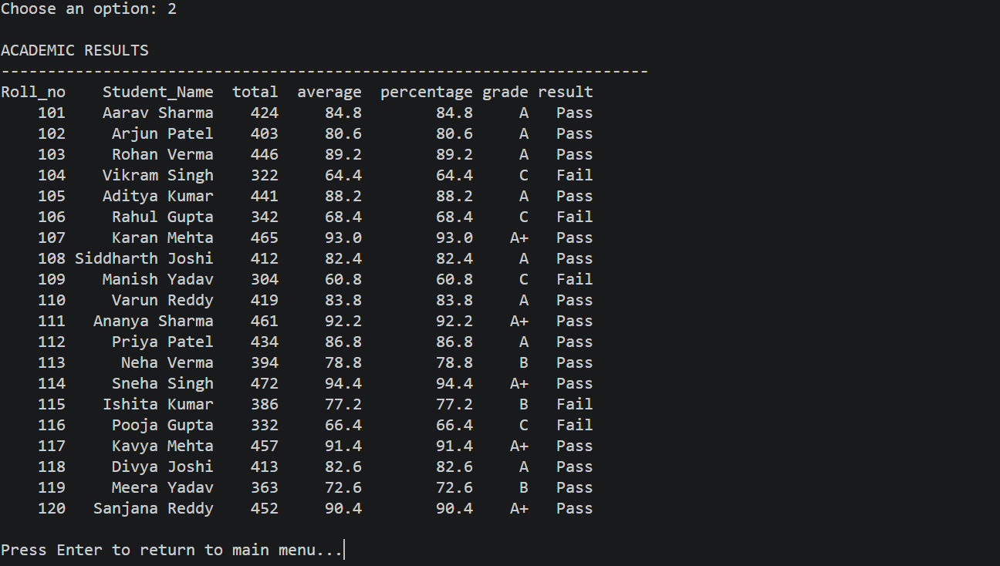
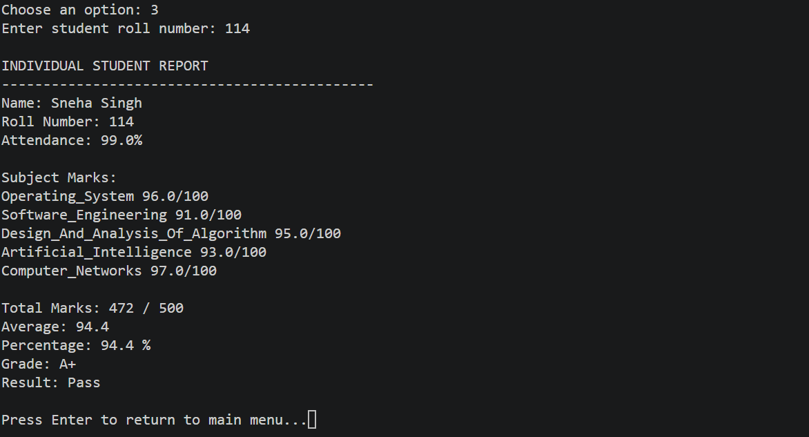
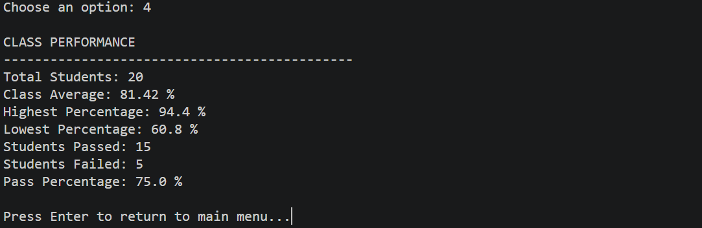
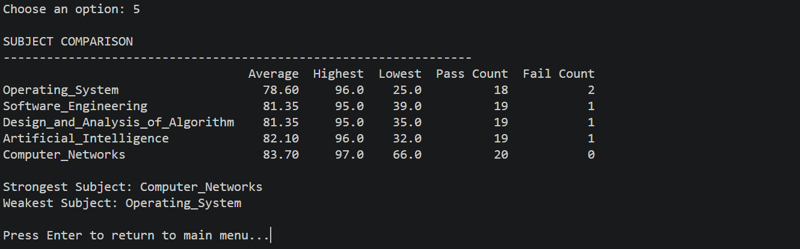
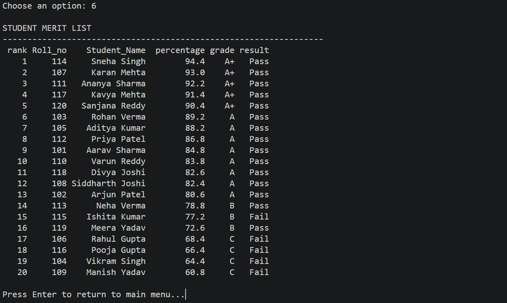
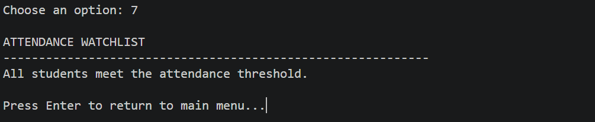

# Student_Performance_Analytics_System

## Project Title and Student Details

- **Project Title:** Student Performance Analytics System
- **Program Name:** Student Assessment Analyzer
- **Developed by:** Mayank Singh

## Objective

This project is made with the objective to automate the analysis of student academic performance using Python, Pandas and NumPy. It calculates the total marks, average marks and percentage, assigns grades, decides which student is pass/fail and checks attendance. It also gives insights such as overall class performance, subject-wise analysis, a merit list and a list of students with low attendance.

## Technologies Used
This project uses the following technologies:
- **Python:** Executes program logic, loops, conditions, functions, modules and the menu-driven interface.
- **NumPy:** Used for numeric calculations and conditional operations(pass/fail and attendance status).
- **Pandas:** Reads the CSV file, stores student records as a DataFrame and analyzes the data.
- **Git and Github**: Used for version control and hosting.
- **Visual Studio Code:** code editor.

## Dataset Description

- The dataset is a CSV file with columns: `Roll_no`, `Student_Name`,  `Attendance`, and `<Subjects>`
- `Roll_no`: Unique roll number of each student. It is read as text, so leading zeroes are not lost.
- `Student_Name`: The student's name.
- `Attendance`: Attendance percentage (0 to 100).
- `<Subjects>`: The remaining columns represents a subject and contains student's marks out of 100 in that subject.
- Refer to `Students_records.csv` for an example. It has 20 student records (roll numbers from 101 to 120).
- Column names must match exactly (they are case-sensitive). The order of columns does not matter.
- The subject names  are fixed in the `SUBJECTS` list in `modules/data_validation.py`.

The CSV file must satisfy these validation rules:
- All required columns(Roll number, Student name, Attendance, Subjects) are present.
- The file contains at least one student record.
- Roll numbers are unique.
- Data types for both attendance and marks are numeric.
- Attendance and marks are between 0 and 100.

## Prerequisites and Usage 

**Prerequisites:**
- Python 3.10 or later
- NumPy
- Pandas

Install the libraries:
`pip install pandas numpy`

**Usage:**
To run the program in the terminal, use the command:
`python main.py path/to/your/csv/file.csv`

For example: `python main.py Students_records.csv`

If no CSV path is given, the program shows the correct comand and exits.

## Implementation 

Program Workflow:
- **Input:** The user gives a CSV file when running the program from the command line.
- **Data Loading:** Pandas reads the CSV file into a DataFrame. Roll numbers are read as text.
- **Data Validation:** The program checks that the file follows the validation rules above. If it does not, an error message is shown and the program stops.
- **Performance Analysis:** It calculates total marks, average, percentage, grade, pass/fail result and attendance status for every student, and stores them in an analyzed DataFrame. This is used for the class statistics, subject comparison, merit list and attendance watchlist.
- **Menu:** The program then shows a main menu and the user chooses the operation they want to execute. After each operation, the user presses Enter to return to the main menu.

Program Structure:
- `main.py`: loads the file, runs the validation and analysis, and controls the main menu.
- `main.py` uses the following modules:
  - `modules/menu.py`: displays the menu and takes the user's choice.
  - `modules/input_handler.py`: takes the roll number input and pauses before returning to the menu.
  - `modules/data_validation.py`: validates the structure and values of the dataset.
  - `modules/performance.py`: calculates total, average, percentage, grade, result and attendance status.
  - `modules/reports.py`: contains the functions that display each report.

How the results are calculated:
- **Total** is the sum of marks in the five subjects (out of 500).
- **Average** is the mean of the five subject marks.
- **Percentage** is: total ÷ 500 × 100.
- **Attendance status** is: `Low Attendance` if attendance is below 75%, otherwise `Satisfactory`.

Error handling:
- The program shows a clear message if the CSV path is missing, the file is not found, the file is empty, the file cannot be read, a required column is missing, there are no student records, roll numbers are duplicated, marks or attendance are not numbers, or marks or attendance are outside 0 to 100.

## Key Features
 
- **View student directory:** shows roll number, name and attendance of every student.
- **View academic results:** shows total, average, percentage, grade and result of every student.
- **Search student report:** shows one student's marks and performance using their roll number.
- **Class statistics:** shows total students, class average, highest and lowest percentage, pass/fail counts and pass percentage.
- **Subject comparison:** shows each subject's average, highest and lowest marks and pass/fail counts. It also shows the strongest and weakest subject.
- **Merit list:** ranks all students by percentage. Students with the same percentage get the same rank.
- **Attendance watchlist:** shows students whose attendance is below 75%, lowest first.

### Menu Options

| Option | Action |
|--------|--------|
| 1 | Student Directory |
| 2 | Academic Results |
| 3 | Search Student Report |
| 4 | Class Statistics |
| 5 | Subject Comaprison |
| 6 | Merit List |
| 7 | Attendance Watchlist |
| 0 | Close Application |

### Grading and Passing Criteria

| Percentage | Grade |
|------------|-------|
| [90-100] | A+ |
| [80-90] | A |
| [70-80] | B |
| [60-70] | C |
| [50-60] | D |
| [40-50] | E |
| [0-40] | F |

A student passes only if they score at least **40 marks in every subject**. A student who scores below 40 in any one subject fails, even if the overall percentage is high.

## Sample Output

## Final Outcome
The program converts raw student records into meaningful performance reports. It supports individual, class-level and subject-wise analysis, ranks students in a merit list, flags students with low attendance, and detects invalid input data before analysis.
 
For the included dataset, the class average is 81.42% and 15 of 20 students pass (75%). Computer Networks is the strongest subject and Operating System is the weakest. All students meet the 75% attendance requirement.

## Challenges and Learning 

- Validating inconsistent or incomplete CSV data using Pandas and showing clear error messages.
- Taking the CSV file path from the command line instead of using a fixed file.
- Reading roll numbers as text so that leading zeros are not lost.
- Using Pandas for reading CSV files, calculations, sorting, filtering and ranking.
- Using NumPy for numeric checks and conditional operations.
- Structuring the program into separate modules.

## Github Repository

Repository: https://github.com/Mayank22016/Student_Assessment_Analyzer.git
